# EBX Connectors — User Guide

*Module `ebx-connectors` for ON EBX 6.3 — configuring and using the connectors, mappings, enrichment services, trust and conflict management.*

This guide is for the people who **configure** and **use** the module in the EBX user interface: data stewards, integration analysts and administrators. The primary journey uses the dedicated **Data connector** perspective and its current catalog, connector workspace, data-flow cards and monitoring pages. The underlying Connectors dataset remains available for advanced administration and audit inspection. The technical reference is in [GUIDE.md](../GUIDE.md).

Connector-specific guides are grouped below. Each guide links back to this original guide.

- Core and databases: [Salesforce](SALESFORCE-USER-GUIDE.html) · [Apache Kafka](KAFKA-USER-GUIDE.html) · [PostgreSQL](POSTGRESQL-USER-GUIDE.html) · [Greenplum](GREENPLUM-USER-GUIDE.html) · [SingleStore](SINGLESTORE-USER-GUIDE.html) · [Firebird](FIREBIRD-USER-GUIDE.html) · [IBM Db2 LUW](DB2-LUW-USER-GUIDE.html) · [InterSystems IRIS](IRIS-USER-GUIDE.html) · [H2](H2-USER-GUIDE.html) · [MySQL](MYSQL-USER-GUIDE.html) · [SAP ASE](SAP-ASE-USER-GUIDE.html) · [SAP HANA](SAP-HANA-USER-GUIDE.html) · [Teradata](TERADATA-USER-GUIDE.html) · [Vertica](VERTICA-USER-GUIDE.html) · [Actian Avalanche / Vector](ACTIAN-VECTOR-USER-GUIDE.html) · [Actian Ingres](ACTIAN-INGRES-USER-GUIDE.html) · [MonetDB](MONETDB-USER-GUIDE.html)
- Messaging, files and cloud data: [RabbitMQ](RABBITMQ-USER-GUIDE.html) · [Amazon SQS](AMAZON-SQS-USER-GUIDE.html) · [Amazon SNS](AMAZON-SNS-USER-GUIDE.html) · [Google Pub/Sub](GOOGLE-PUBSUB-USER-GUIDE.html) · [SFTP](SFTP-USER-GUIDE.html) · [FTP / FTPS](FTP-FTPS-USER-GUIDE.html) · [Azure Queue Storage](AZURE-QUEUE-STORAGE-USER-GUIDE.html) · [Azure Table Storage](AZURE-TABLE-USER-GUIDE.html) · [Google Sheets](GOOGLE-SHEETS-USER-GUIDE.html) · [Google Drive](GOOGLE-DRIVE-USER-GUIDE.html) · [Microsoft OneDrive](ONEDRIVE-USER-GUIDE.html)
- Data platforms and repositories: [Apache Cassandra](CASSANDRA-USER-GUIDE.html) · [Azure Cosmos DB](AZURE-COSMOS-DB-USER-GUIDE.html) · [MongoDB](MONGODB-USER-GUIDE.html) · [Couchbase](COUCHBASE-USER-GUIDE.html) · [Elasticsearch](ELASTICSEARCH-USER-GUIDE.html) · [CMIS](CMIS-USER-GUIDE.html) · [Hadoop WebHDFS / HttpFS](HADOOP-WEBHDFS-USER-GUIDE.html) · [Apache Spark SQL](SPARK-SQL-USER-GUIDE.html)
- Document feed and CDC: [Documents with AI extraction](DOCUMENTS.md) · [Debezium CDC applied to EBX](CDC.md)
- Document formats: [Excel](EXCEL-USER-GUIDE.html) · [Word DOCX extraction](DOCX-USER-GUIDE.html) · [Avro](AVRO-USER-GUIDE.html) · [Parquet deployment gate](PARQUET-USER-GUIDE.html)
- Business, catalog and reference data: [GLEIF](GLEIF-USER-GUIDE.html) · [Veeva Vault](VEEVA-VAULT-USER-GUIDE.html) · [Alation](ALATION-USER-GUIDE.html) · [Microsoft Purview](MICROSOFT-PURVIEW-USER-GUIDE.html) · [HCL Domino REST](DOMINO-REST-USER-GUIDE.html) · [MedPro evidence gate](MEDPRO-USER-GUIDE.html) · [ZoomInfo evidence gate](ZOOMINFO-USER-GUIDE.html)

---

## Contents

1. [What the module does](#1-what-the-module-does)
2. [Working from the Data connector perspective](#2-working-from-the-data-connector-perspective)
3. [Configuring a connector](#3-configuring-a-connector)
4. [Creating a connector from an OpenAPI specification](#4-creating-a-connector-from-an-openapi-specification)
   4b. [Adding a connector type without the module sources](#4b-adding-a-connector-type-without-the-module-sources)
5. [Mappings](#5-mappings)
6. [The graphical mapping designer](#6-the-graphical-mapping-designer)
7. [Running an enrichment](#7-running-an-enrichment)
8. [Trust, provenance and conflicts](#8-trust-provenance-and-conflicts)
9. [Managing conflicts](#9-managing-conflicts)
10. [Monitoring: the synchronisation log](#10-monitoring-the-synchronisation-log)
11. [Feeding a data catalog](#11-feeding-a-data-catalog)
12. [Quick reference](#12-quick-reference)

---

## 1. What the module does

The module connects EBX to external systems and services **without code**: a business register (GLEIF, INSEE Sirene, Companies House, Handelsregister), a data provider (Dun & Bradstreet, Orbis, Creditsafe), an address service (Melissa, Loqate, BAN, Google Geocoding), a CRM or ERP (Salesforce, Dynamics 365, SAP, JD Edwards, Oracle Fusion, HubSpot, ServiceNow, Workday), a data platform (Snowflake, Databricks, BigQuery, any JDBC database), a BI or governance tool (Power BI, Collibra), a lineage sink (OpenLineage), a message bus (Kafka), a file drop (SFTP, S3, Azure Blob, Google Cloud Storage), a sanctions screening service (OpenSanctions), Wikidata, another EBX instance, a Slack workspace or a Teams channel, a large language model used as a low-trust enrichment source, or **any REST, SOAP or GraphQL API** described by properties or imported from an OpenAPI specification.

Three ideas carry everything:

| Concept | What it is | Example |
|---|---|---|
| **Connector** | A configured access to one external system: URL, authentication, options, and a **trust level**. | `GLEIF` — the public LEI registry, trust 90 |
| **Mapping** | For one connector operation and one EBX table: what is sent to the service (the *inputs*) and how its answer is written into EBX (the *rules*), or the reverse for an outbound mapping. | "GLEIF record → company legal information" |
| **Enrichment** | Running one or several mappings on a record or a table: from the user interface, the REST API, a workflow, a scheduled task or a table trigger. | Enrich *Exemplar Industries* with Wikidata, INSEE and VIES |

Every write done by a connector is remembered (**provenance**), and when a less trusted source disagrees with a more trusted one, the proposal is kept as a **conflict** for a steward to decide.

## 2. Working from the Data connector perspective

Open the **Data connector** perspective from the EBX perspective selector. It is the normal home for connector work and keeps workflow, connectivity, conflict and run-monitoring tasks together.

| Perspective section | What you use there |
|---|---|
| **Workflow** | To-do list, launch a workflow, ongoing workflows and completed workflows |
| **Connectivity Management** | **Connection catalog** and **Mappings** |
| **Conflicts** | The open conflict backlog for steward decisions |
| **Runs and monitoring** | Connector operations, execution runs, synchronisation log, outbound deliveries, checkpoints and connector metrics |

Start with **Connectivity Management › Connection catalog**. Each card is a configured connection (a connector type with its properties and credentials); **New connection** opens the standard creation form of the Connector table. Search by connection name, description or type, and narrow the list with the filters on the left — **Favorites**, **Category**, **Status**, **Connection** — or with the **Advanced filters** (authentication, used by a mapping or not). Filters combine, each value shows how many connectors it would give, and the active ones appear as removable chips under the search box. Sort by name, number of mappings or trust. Click the **star** of a card to pin a connector: **My favorites** then shows only yours (favorites are personal). Each card shows setup/connection state, category, implementation, summary and how many mappings use it. Open the card to stay inside the Data connector perspective and enter the connector workspace.

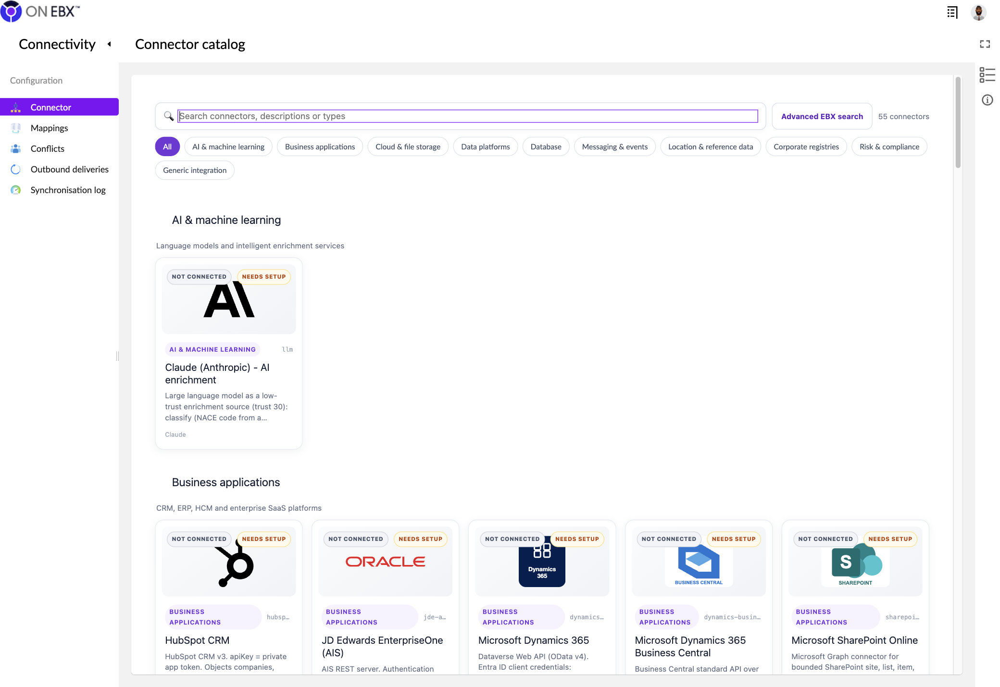

The connector workspace has three tabs: **Main** for identity and activation; **Connection & configuration** for endpoint, authentication, encrypted credentials, runtime policy, properties and diagnostics; and **Data flows** for mapping cards with **Edit flow**, **Design & test** and **Run flow** actions. Opening and closing a connector stays in the perspective from which it was launched.

### The underlying Connectors dataset

The whole configuration is **data**, in the dataspace `Connectors`, dataset `Connectors`. The module creates it at the first start and seeds it with ready-made connectors of the 59 available types and demonstration mappings on the `Companies` table. No file to edit, no redeployment to change a mapping.

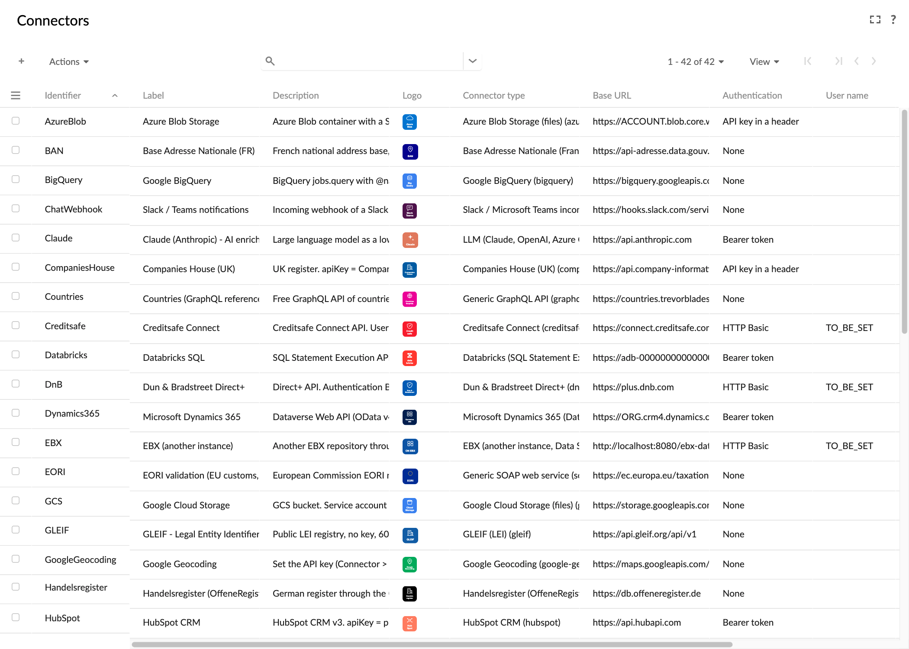

| Table | Content |
|---|---|
| **Connector** | the configured connectors (identifier, type, base URL, authentication, trust level) |
| **Connector property** | options of a connector (`country = FR`, `op.search.path = /search`…) |
| **Mapping** | the mappings; each has its **inputs** (service call), **rules** (field links) and **sub-object** mappings |
| **Field provenance** | which connector wrote which field of which record, with its trust level |
| **Conflict** | the proposals refused by the TRUSTED policy, waiting for a steward decision |
| **Outbound deliveries** | per outbound mapping and record: last successful send, fingerprint, failures to replay, deletions |
| **Synchronisation log** | one line per call: connector, operation, record, status, message, duration, run identifier |

> **Another data model than the demonstration one?** The connectors are always seeded; the demonstration
> mappings are created only when their table exists, with the rules whose fields exist (JVM property
> `ebx.connectors.seedMappings=auto|always|never`). Whatever the origin of a mapping, the validation report
> of the Connectors dataset warns when its dataset or table cannot be found, or when a rule or an input
> references a field the table does not have.

> **Libraries.** The module only needs EBX and Jackson. Four connector types need an extra jar in the
> server's `lib`: Kafka (`kafka-clients`),
> SFTP (`jsch`), and the JDBC-based types (the database driver). Without the jar, the type is simply absent
> from the list. The reference guide, section 18, gives the Maven coordinates.

## 3. Configuring a connector

From **Data connector › Connectivity Management › Connection catalog**, open a connection card. Use the raw **Connector** table only for advanced table administration or bulk inspection.

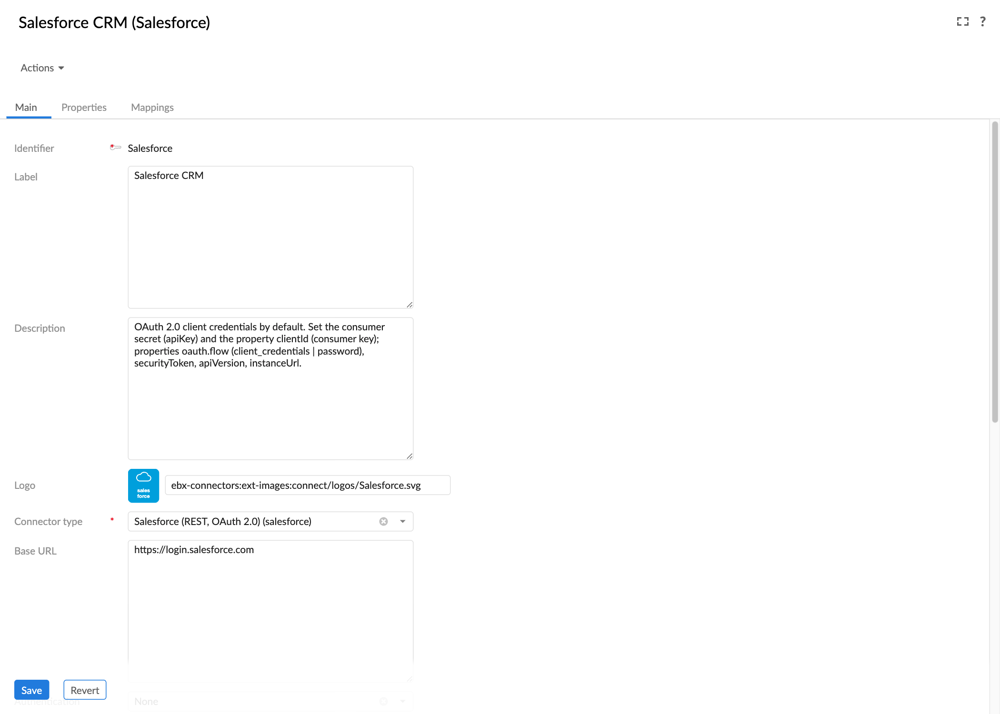

Fill in:

- **Identifier**: referenced everywhere (mappings, workflow parameters, REST calls). Keep it short, without spaces.
- **Logo**: the image shown with the connector in the form, the table and the mapping designer. Every seeded connector has one; put your own SVG or PNG in `www/common/images/connect/logos` of the module and reference it as `ebx-connectors:ext-images:connect/logos/<file>`. For a **tile view** of the Connector table, choose the computed field **Logo URL** as the image:

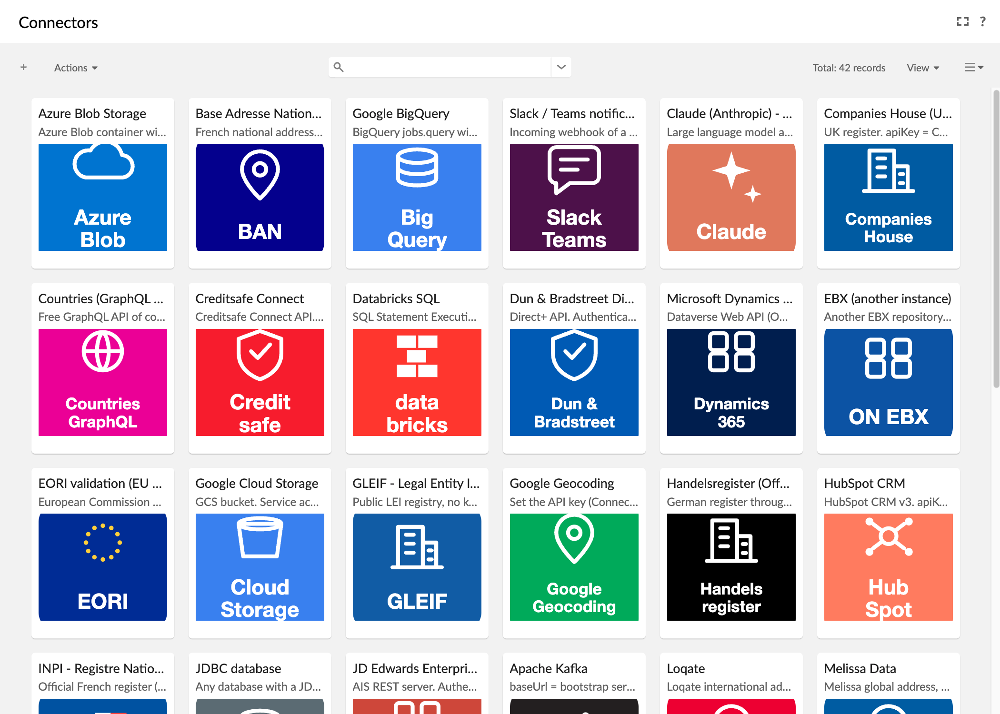
- **Connector type**: a list of the types registered in the module. `rest` is the generic type for any REST API described by properties (see the next section); the others (`gleif`, `sirene`, `melissa`, `salesforce`, `kafka`, `jdbc`…) know their service and only need the URL, the credentials and a few options.
- **Base URL**: the root of the calls (or the JDBC URL, `sftp://host`, the Kafka bootstrap servers).
- **Authentication**: `None`, `HTTP Basic`, `API key in a header`, `Bearer token` or `OAuth 2.0`. You do not need to know which
  credential field goes with which mode: the **Connection & configuration** tab says it. The modes the connector type supports
  appear as cards, the others greyed out; each credential field carries a state (*required*, *optional*, *derived*, *not used*)
  and a label for what it holds in this mode (*API key / token* reads *Client secret* in OAuth 2.0, *Token* in Bearer, *Google
  Maps Platform key* for Google Geocoding). The side panels list what to enter, where to get it at the provider, and what the
  module actually sends. A counter warns when a pasted secret is longer than the 255 characters the field accepts, which is
  typically a short-lived Microsoft Entra token pasted in Bearer mode: use OAuth 2.0 with a service principal instead.

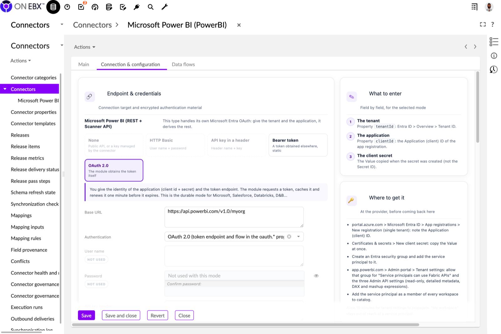

The current connection workspace groups endpoint and encrypted credentials on the left, runtime policy and diagnostics on the right, and type-specific properties below. Save changes before choosing **Test connection** or **Open connector diagnostics**.

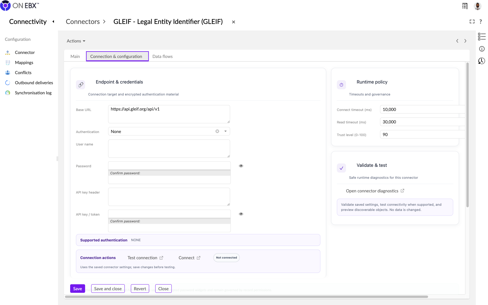

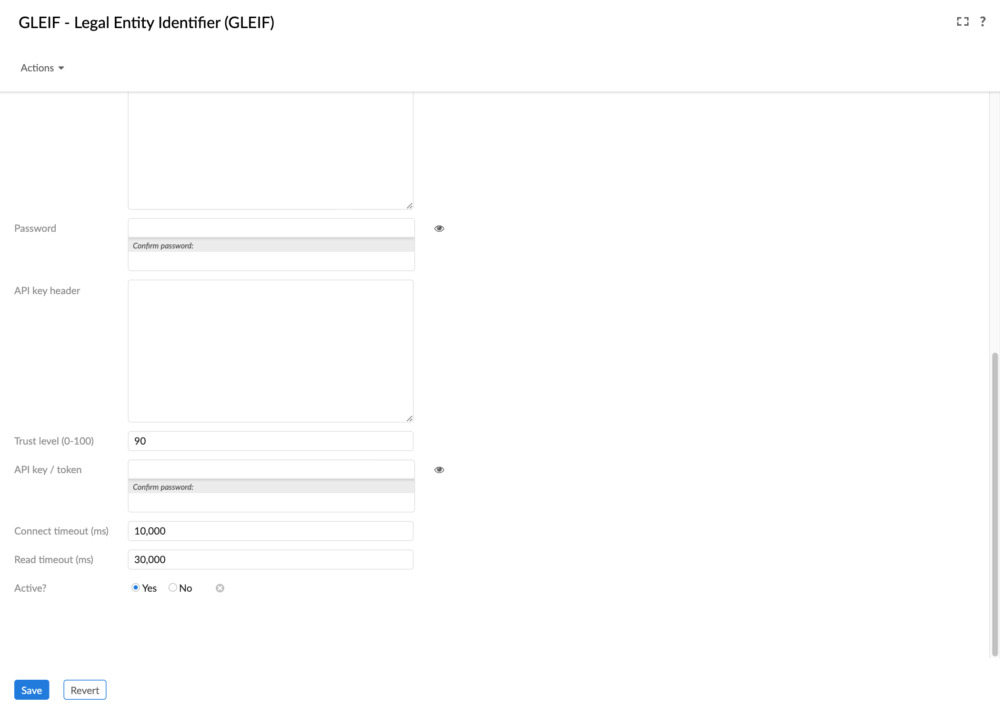

- **Password** and **API key / token** are **encrypted**. A secret left as `TO_BE_SET` means "not configured": the connector refuses to call and says which field to fill. Enter secrets **in this form**: they are stored with EBX's reversible encryption and decrypted by the module. A value written in clear through Data Services or an import is accepted as is, but stays in clear in the repository. A secret changed here is used at the next call, without restart. A secret may also be a **reference** to a vault (`vault:secret/data/ebx/sirene#apiKey`, `azurekv:myvault/sirene-key`, `env:SIRENE_KEY`, `file:/run/secrets/sirene`): the value then stays outside EBX and a rotation is picked up without restart. The `OAuth 2.0` authentication takes its token endpoint and flow from the `oauth.*` properties (client credentials, password, refresh token or JWT bearer with a certificate); `tls.*` properties add a client certificate or a private CA; a webhook caller can sign its calls (HMAC-SHA256, `X-Webhook-Signature`). Four JVM properties harden a deployment: `ebx.connectors.allowedHosts` (the only hosts the module may call), `ebx.connectors.adminRole` (who may edit connectors and mappings), `ebx.connectors.log.retentionDays` and `ebx.connectors.log.storeChanges` (what the synchronisation log keeps, and for how long); secrets are masked in every message the module keeps or returns.
- **Trust level (0-100)**: how much the module believes this source when it disagrees with another one (section 8). The seeded values put the official registers first: GLEIF, Sirene, Companies House 90; D&B, Orbis, Handelsregister 85; VIES, Creditsafe, OpenSanctions 80; Melissa, Loqate 75; BAN, OpenCorporates, SAP, JDE 70; Google, CRM and ERP 60; Wikidata 40; default 50. A value typed by hand counts as 100.
- **Connect / read timeouts** and **Active?**.

Type-specific options are shown in **Connection & configuration**. The **Data flows** tab presents the connector's inbound and outbound mappings as cards.

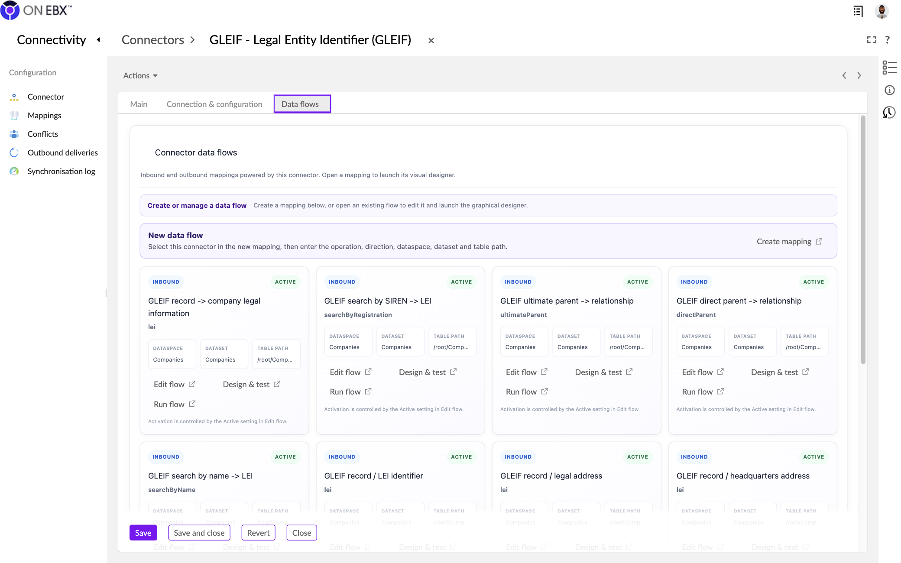

> **Tip.** Connectors that need no key work immediately: GLEIF, VIES, BAN (French addresses), Wikidata, Handelsregister, and the connector imported from the French *Recherche d'entreprises* API. They are enough to demonstrate a full enrichment.

## 4. Creating a connector from an OpenAPI specification

Any API that publishes an **OpenAPI 3** specification (JSON or YAML) becomes a connector in one step. On the **Connector** table, open **Actions › Import an OpenAPI specification**.

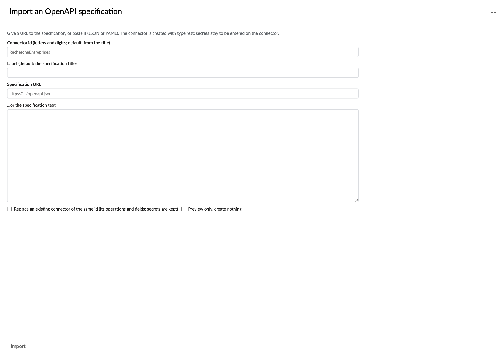

- **Connector id** and **Label** (defaults come from the specification title).
- **Specification URL**, or paste the **specification text**.
- **Replace an existing connector of the same id**: refreshes its operations and fields, keeps its secrets.
- **Preview only**: shows what would be created (operations, parameters, fields) without writing anything.

The importer creates a connector of type `rest` with one **operation per path** (GET reads, POST/PUT writes), the required and optional parameters, the fields of the answers (used by the designer to propose the source fields), and the security scheme (API key in a header or a query parameter, Basic, Bearer). Secrets stay to be entered on the connector.

Example used in this guide: `https://recherche-entreprises.api.gouv.fr/openapi.json` gives the connector `RechercheEntreprises` with the operations `search` and `near_point`.

## 4b. Adding a connector type without the module sources

A developer can add a connector **type** (a new entry in the *Connector type* list) by delivering a jar,
without touching the module:

1. They compile a class implementing `com.on.ebx.connect.spi.Connector` (usually by extending
   `AbstractRestConnector`) against **`ebx-connectors-spi.jar`**, the contract shipped in the `dist`
   folder of the module, plus `ebx.jar` (or `ebx-lib.jar` on FastTrack) and Jackson.
2. The jar contains the file `META-INF/services/com.on.ebx.connect.spi.Connector` with the class name.
3. The administrator copies the jar into `ebx-connectors/WEB-INF/lib/` and restarts the server.

The type then behaves like a built-in one: its operations appear in the *Operation* list of the mapping
form, and **Load the external fields** in the designer shows the fields it declares. The project
`ebx-connectors-extension-sample` is a complete example (an OpenStreetMap Nominatim geocoder) to copy.

## 5. Mappings

Open **Data connector › Connectivity Management › Mappings** for the complete list. To work from one connector, open its catalog card and use **Data flows**; choose **Edit flow**, **Design & test**, or **Run flow** on a card. Each mapping is one connector operation applied to one EBX table, in one direction.

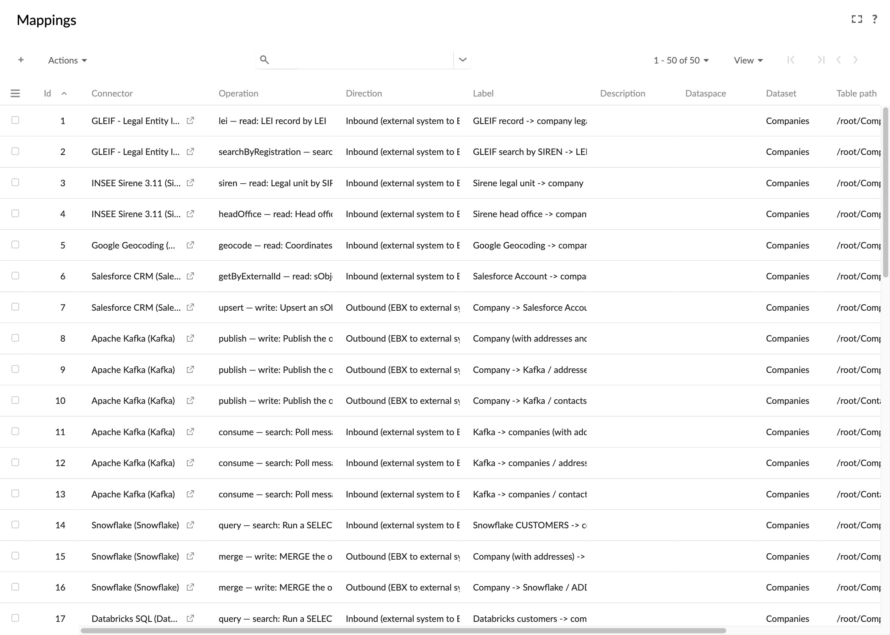

Open a mapping (or create one with **+**): the form is organised in tabs.

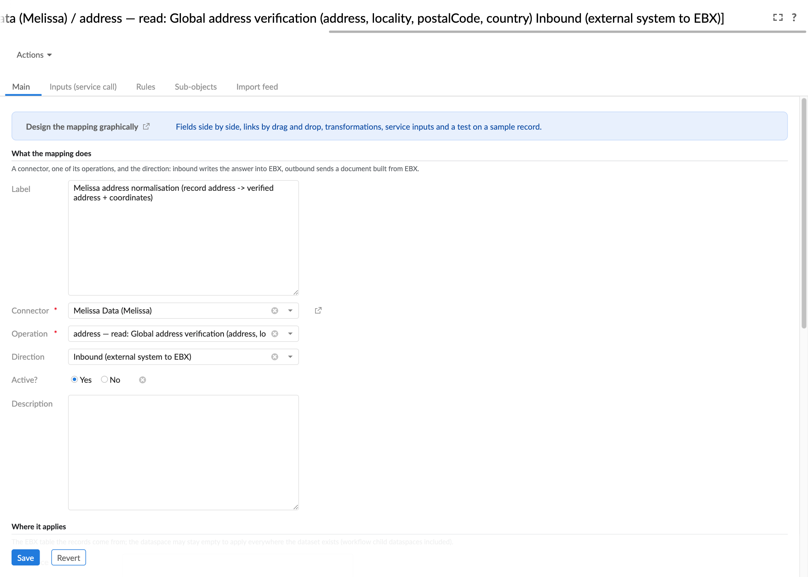

- **Main**: the **connector**, its **operation** (the list shows the operations of the chosen connector, with their meaning: *read*, *search*, *write*…), the **direction** (*Inbound*: the answer of the service is written into EBX; *Outbound*: a document built from EBX is sent to the service), the target **dataset** and **table**, and the **Active?** flag. The banner at the top opens the graphical designer.
- **Inputs (service call)**: the parameters sent to the service, computed from the record with expressions such as `${./Address/Street}` or `${./LegalInformation/registrationNumber|vatfr}`.
- **Rules**: one line per field link — source path in the answer, target field in EBX, transformation pipeline, write policy.

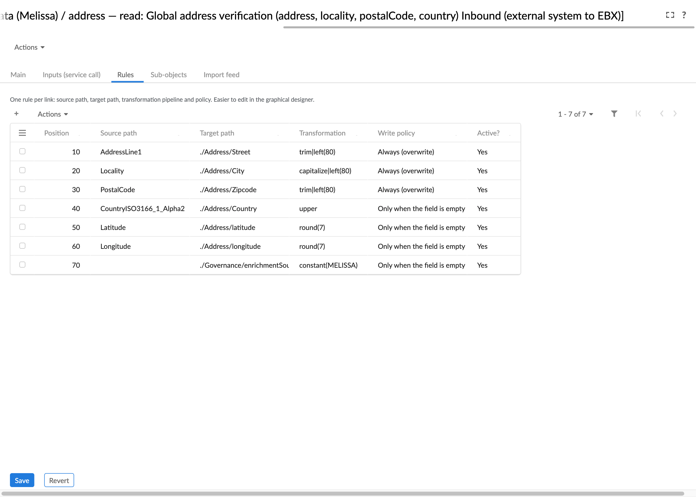

- **Sub-objects**: child mappings that write the elements of a collection of the answer (addresses, identifiers, contacts) into a child table linked to the record.
- **Import feed**: for mappings that import a whole document or stream (Kafka, webhook, SQL query, file): where the items are, how to find the existing record, whether to create missing ones.

### The write policy of a rule

| Policy | Behaviour |
|---|---|
| **Only when the field is empty** (`IF_EMPTY`, default) | fills the gaps and never overwrites |
| **Always** (`ALWAYS`) | the service is the master of the field |
| **Trusted** (`TRUSTED`) | writes when the field is empty **or when this source is at least as trusted as the one that wrote the current value**; otherwise logs a conflict (section 8) |

### Expressions and transformations

Inputs and rules use the same small language. An expression mixes text and placeholders: `${./Address/City}`, `${param.country}`, and a placeholder can carry a pipeline of transformations: `${./Identification/Name|trim|upper|left(80)}`. Placeholders can be nested: `${./LegalInformation/registrationNumber|default(${./Identification/Name|upper})}` sends the SIREN when present, else the upper-cased name.

The transformations available in a pipeline (also offered by the designer): `trim`, `upper`, `lower`, `capitalize`, `left(n)`, `right(n)`, `substring(a,b)`, `replace(a,b)`, `regex(pattern,group)`, `digits`, `vatfr`, `prefix(p)`, `suffix(s)`, `default(v)`, `constant(v)`, `nullIfEmpty`, `nullIf(v)`, `isoDate`, `isoDateTime`, `date(in,out)`, `map(A=B;C=D;*=default)`, `join(sep)`, `first`, `count`, `boolean`, `number`, `round(n)`, `fk(/root/Table[,dataspace,dataset])` (keeps the value when the referenced record exists, following the model's foreign keys to other datasets), `lookup(/root/Table,./field,./result)`, `golden(/root/Table[,dataspace,dataset])` (resolves a record's key to its Match and Merge golden record's key when it is merged, else unchanged), `mdmState(/root/Table[,dataspace,dataset])` (that record's Match and Merge state, or `UNMANAGED`).

## 6. The graphical mapping designer

From a mapping record, click **Design the mapping graphically** (banner at the top of the form, or **Actions › Design the mapping**).

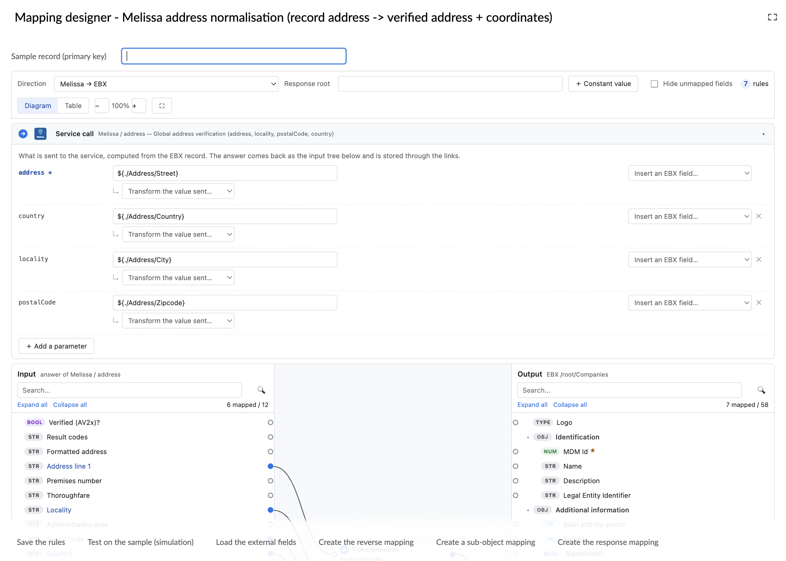

The screen has three areas:

1. **Service call** (top): the parameters sent to the service. Each one has an expression; **Insert an EBX field…** adds a field placeholder, **Transform the value sent…** appends a transformation. Required parameters are marked with `*`. **Add a parameter** declares an extra one.
2. **Input / Output trees** with the **diagram** between them: the answer of the service on the left (with a sample value when a sample record was loaded), the EBX table on the right. **Drag a field from the input side onto a field of the output side** to create a link. Transformation nodes appear on the links.
3. **Selected link** (below the diagram): the pipeline of the selected link, step by step, its write policy and a comment.

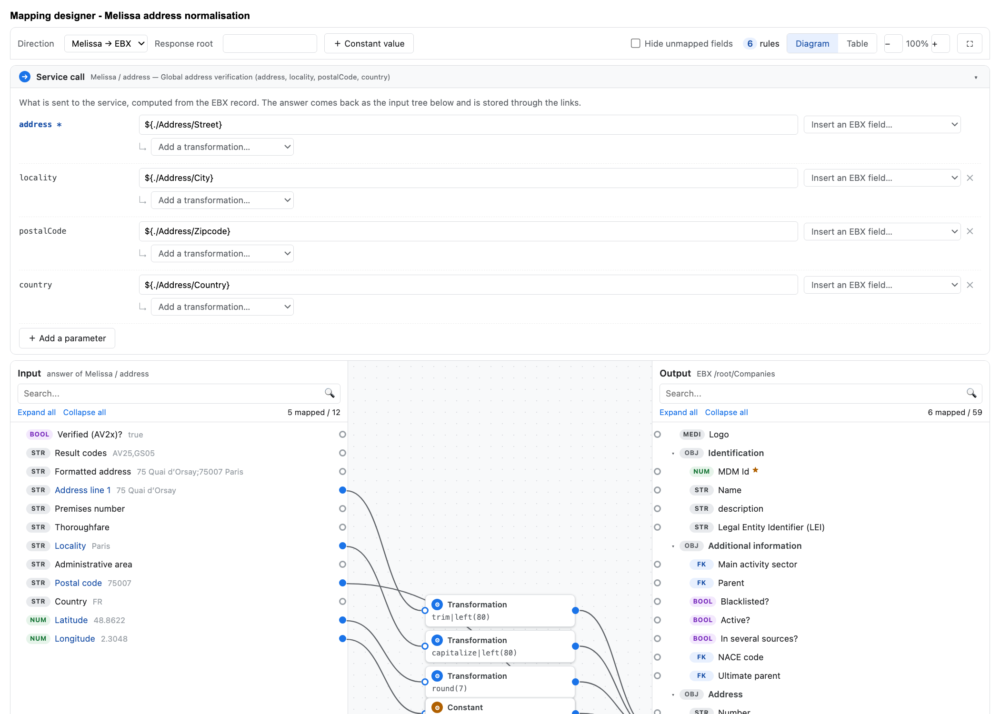

Editing a link: click it (or its transformation node). Each step can be removed with ✕, a new one is added with **Add a step…**; the text of the pipeline can also be typed directly. The policy list offers *Only if empty*, *Always* and *Trusted*.

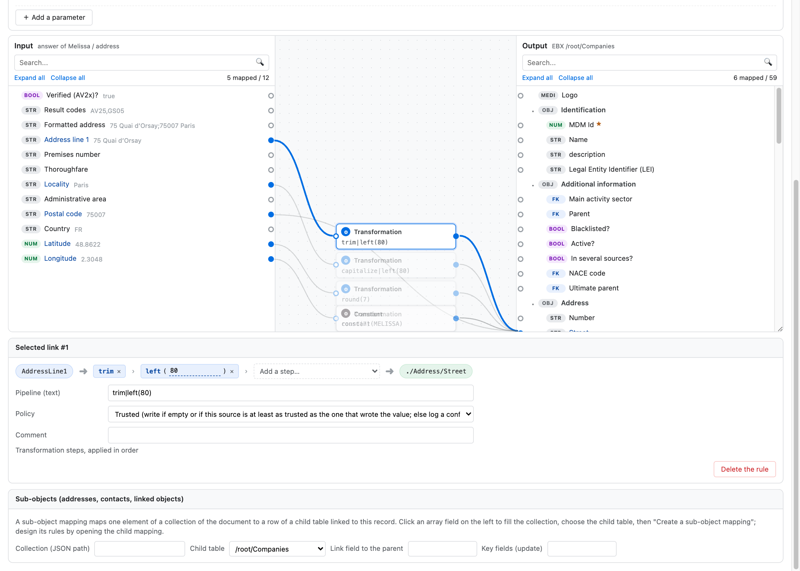

The **Table** view shows the same links as a list (source, transformation, target, policy, comment), handy for long mappings.

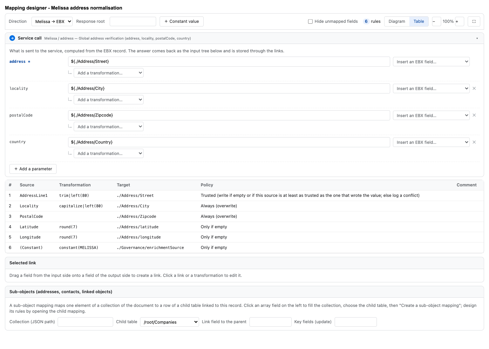

Toolbar and buttons:

- **Direction** (*Melissa → EBX* or *EBX → Melissa*); changing it clears the links, so use **Create the reverse mapping** to keep both.
- **Response root**: when the useful part of the answer is under a node (for instance `data`), set it here so that the paths stay short.
- **Constant value**: a link with no input, whose value is written into the output field (`constant(MELISSA)` in a governance field, for instance).
- **Hide unmapped fields**, search boxes, **Expand / Collapse all**, zoom **− / +**, and **⛶** full screen for large models.
- **Save the rules** writes the links into the *Rules* table.
- **Test on the sample (simulation)** calls the service for the sample record (the key typed in *Sample record*, or the first record) and shows what would change, without writing.
- **Load the external fields** calls the service once to discover the fields of the answer and their sample values; when the connector declares a catalogue of fields (imported from OpenAPI, or built into the type), it is shown without calling.
- **Create the reverse mapping**, **Create a sub-object mapping** (click an array field on the input side, choose the child table and the link field to the parent, then design its rules by opening the child mapping), **Create the response mapping** (for an outbound mapping: what to store back from the answer, for instance the identifier assigned by a CRM).

## 7. Running an enrichment

### From a table, in the user interface

On any table with at least one mapping, **Actions › Synchronise with an external application**.

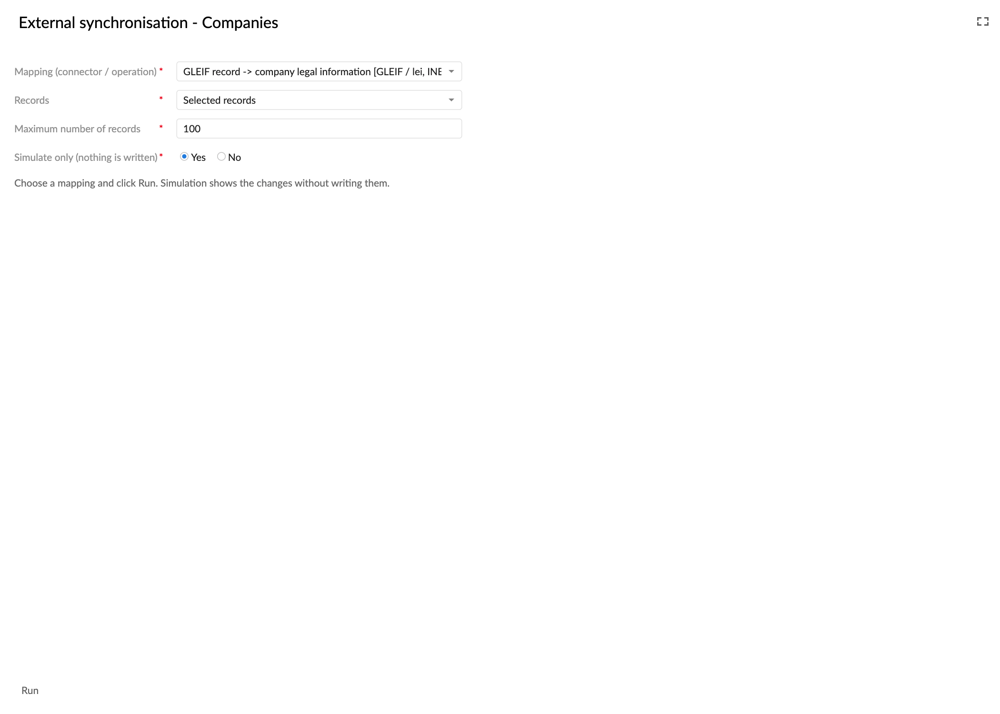

Choose the **mapping**, the **records** (selected records, displayed records, whole table), a **maximum number**, and the **run mode**: **Simulate** (the default) previews without writing anything, **Run for real** writes. The result lists the records with their status (`OK`, `NO_CHANGE`, `NO_DATA`, `SKIPPED`, `ERROR`, `DRY_RUN`), the changes and the message, errors first, 20 at a time (scroll or click **Show 20 more**), with status filters; after a simulation, **Apply these changes** runs the same options for real. A real run on the whole table asks for a confirmation first.


### Sending only what changed, and replaying failures

For an outbound mapping, the *Records* list of the service (and the `scope` parameter of the API, the
workflow bean and the scheduled task) offers, besides the selected records and the whole table:
**Not sent yet**, **Changed since the last send** (fingerprint of the document, failures to retry and
deletions when the mapping declares a delete operation), **Failed sends to retry**, and **Created,
modified or deleted since the initial snapshot** of a child dataspace. The *Outbound deliveries* table
of the Connectors dataset shows, per mapping and record, the last successful send and the failures with
their error. Every execution has a run identifier, shown in the log; `POST /ebx-connectors/rest/v1/replay/<runId>`
re-runs its failed calls.

### From the REST API

Base `http://<host>/ebx-connectors/rest/v1`, EBX authentication (Basic or token); `dryRun=true` everywhere.

```bash
# the catalogue, and the mappings of a table
curl -u user:pwd http://localhost:8080/ebx-connectors/rest/v1/connectors
curl -u user:pwd "http://localhost:8080/ebx-connectors/rest/v1/mappings?table=/root/Companies"

# an ordered sequence of mappings on one record (ids or labels), or by connector
curl -u user:pwd -X POST "http://localhost:8080/ebx-connectors/rest/v1/enrich?dataset=Companies&table=/root/Companies&key=513&mappings=37,49,30"
curl -u user:pwd -X POST "http://localhost:8080/ebx-connectors/rest/v1/enrich?dataset=Companies&table=/root/Companies&key=513&connectors=GLEIF,VIES,BAN"

# a document pushed by an external application through a feed mapping (webhook)
curl -u user:pwd -X POST "http://localhost:8080/ebx-connectors/rest/v1/webhook/34" -H "Content-Type: application/json" \
     -d '{"items":[{"siren":"123456789","name":"Exemplar Industries","city":"Paris","country":"FR"}]}'
```

The answer details each mapping (`status`, `message`, `changes`, `conflicts`) and summarises: `ok`, `errors`, `conflicts`, `hasConflicts`.

### From a workflow

The module provides the script task bean **`com.on.ebx.connect.ebx.workflow.ConnectorScriptTaskBean`** and the ready-made workflow model **`ConnectorEnrichment`**. Inputs: `dataspace`, `dataset`, `xpath` (one record) or `tablePath` + `predicate` + `maxRecords` (a table), `mappings` (ordered list) or `connectors`, `dryRun`, `failOnError`. Outputs: `report`, `changedCount`, `okCount`, `errorCount`, `status`, `truncated` (the run stopped at `maxRecords`, default 200), `warnings` (run-time inputs no mapping read), and **`conflictCount` / `hasConflicts`** that route the workflow to the conflict resolution task (section 9).

In the workflow editor, declare the step as a **library** script task and pick the bean in the list of module `ebx-connectors`: the step form then shows every parameter, each mapped to a data context variable (`mappings` = `${mappings}`, `xpath` = `${xpath}`...) that is asked at launch. A "specific" task typed with the bare class name runs too, but without the parameter form.

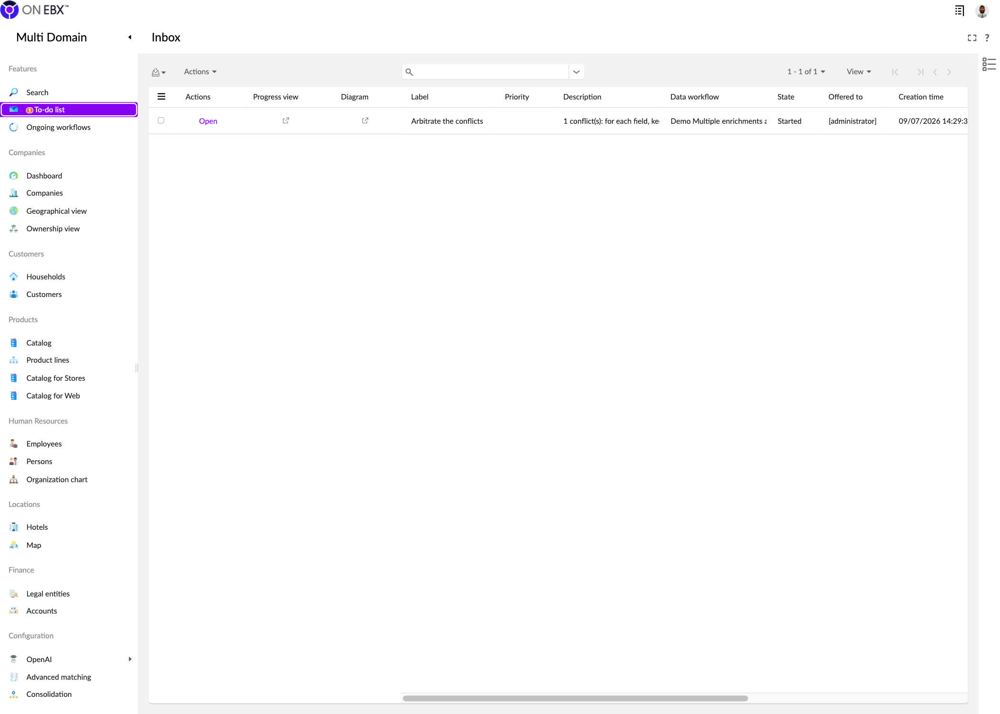


### Telling Slack that a task is waiting

A workflow can announce its tasks in Slack, so that nobody has to watch their EBX inbox. Each new work item is
posted to a channel with its title, its description, who it is offered to, and a link that opens it in EBX; when
the task ends, that same message becomes "✅ Accepted by Ana" or "❌ Rejected by Ana" — it is edited, not repeated.

The decision itself is always taken in EBX, in the person's own session: they click the link, EBX opens the task
(and takes it for them), they accept or reject there. Nothing is decided from inside Slack, so EBX records the
real decision maker and applies their permissions, and Slack never needs to reach your server.

To set it up:

1. Configure the `Slack` connector: the bot token of your Slack app in the token field, and the default channel in
   its property `channel` (section 3 shows where credentials go).
2. On the workflow model, set the workflow trigger to
   `ebx-connectors@com.on.ebx.connect.ebx.workflow.ChatWorkItemTrigger`, then republish the model. Workflows
   already running keep their previous publication and stay silent.
3. Optionally, on the connector: `workflow.channel.<role>` sends the tasks offered to a role to their own channel
   (`workflow.channel.Steward = #stewards`), `workflow.baseUrl` is the address your users open EBX with — set it,
   otherwise the links point at `localhost` and only work on the server itself —, and `workflow.startWorkItem =
   false` makes the link show the task without taking it.

A Slack failure never stops the workflow: it is written to the synchronisation log (section 10) and the task
proceeds. Two limits worth knowing: a chat webhook connector can post the message but not edit it afterwards, and
a workflow instance terminated by force leaves its message on the "waiting" version, with a link that no longer
opens anything.

### Deleting a mapping

Deleting a mapping in the table cascades to its rules, inputs, sub-object mappings and outbound states (a trigger of the Mapping table does it whatever the way the row is deleted); provenance and conflict rows keep their history and only lose the reference. The action **Delete this mapping and everything attached**, on a mapping or on selected rows, shows what will go before asking for confirmation.

### MCP tools for agents

The module exposes its features as 23 MCP tools (list and describe connectors, call an operation, list, create, update and delete mappings, enrich a record, synchronise or publish, replay a run, stop a running import, arbitrate conflicts, search the log, export and import the configuration, import an OpenAPI specification, declare the lineage of the mappings, see how the data catalog knows a connector's system). An agent reaches them through the native MCP runtime of EBX 6.3 (`/ebx-assistant/mcp/v1/ebx-connectors`, when EBX accepts the module's registration) or through the module's own endpoint `POST /ebx-connectors/rest/mcp`, with EBX credentials. Start with `connectors_help`.

### Scheduled task and table trigger

- **Scheduled task** `com.on.ebx.connect.ebx.scheduler.ConnectorScheduledTask`: a connector/operation on a table with a predicate, every night for instance (*GLEIF / lei* on the companies whose LEI is set and whose GLEIF date is empty).
- **Table trigger** `com.on.ebx.connect.ebx.trigger.ConnectorTableTrigger`, declared on a table of the data model: runs a connector on creation, or when one of the watched fields changes, blocking or not.

## 8. Trust, provenance and conflicts

Several sources can describe the same company, and they do not always agree. The module decides with **trust levels**:

- every connector has a **trust level** (section 3); a value typed by hand, or loaded outside the connectors, counts as 100;
- every write by a connector is recorded in **Field provenance**: record, field, connector, trust, value, date. This is the audit trail of the enrichment;
- a rule with the **Trusted** policy writes when the field is empty, or when its source is at least as trusted as the one that wrote the current value. A source can therefore refresh its own data, and a better source corrects a worse one; but a weaker source never overwrites silently: its proposal goes to the **Conflict** table.

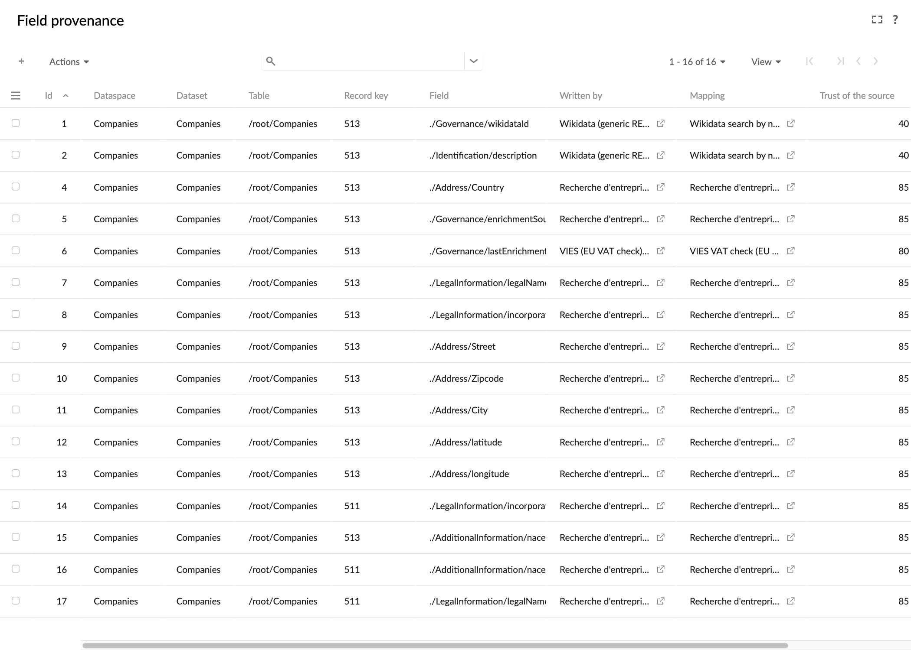

Example on *Exemplar Industries*: Wikidata (40) fills the empty legal name with "Exemplar Industries"; the INSEE-based *Recherche d'entreprises* connector (85) overwrites it with the official name; when Wikidata runs again it is refused and a conflict is logged; VIES (80), which prefixes the legal form, is refused too. On *Microsoft France*, whose name was typed before the module existed (provenance unknown = manual = 100), every connector proposal ends as a conflict.


## 9. Managing conflicts

Conflicts are steward decisions. Three ways to know that some are waiting:

- the REST answers carry `conflicts` and `hasConflicts`, and `GET /ebx-connectors/rest/v1/conflicts?dataset=Companies` lists them;
- the workflow bean returns `hasConflicts`, and the `ConnectorEnrichment` workflow creates a **Resolve the conflicts** task when it is true;
- the synchronisation log counts them in the message of each call.

The **Manage connector conflicts** screen is available on a **dataspace** (Actions menu, or as a perspective action: every conflict of the dataspace), on a **table** (its conflicts), on a **record** (its conflicts), on the **Conflict table** itself (the whole open backlog, or the conflicts selected in the view), and as a **workflow user task**.


For each conflict the screen shows the record, the field, the **current value** (who wrote it and with which trust) and the **proposed value** (by whom, with which trust). Choose per line:

- **Take the proposed value**: the value is written into the record, the proposing connector becomes the provenance of the field (with the trust it had), the conflict becomes *Accepted*;
- **Keep the current value**: the conflict becomes *Rejected*, nothing changes in the record;
- **Decide later**: the conflict stays open.

Then click **Apply the decisions**. **Take all proposed values** and **Keep all current values** decide everything at once; the *Comment* is stored on every conflict decided in the round, with the user and the date.

In a workflow, the same screen is the user task; **Complete the task** closes the work item and returns `resolvedCount` and `remainingCount` to the workflow.

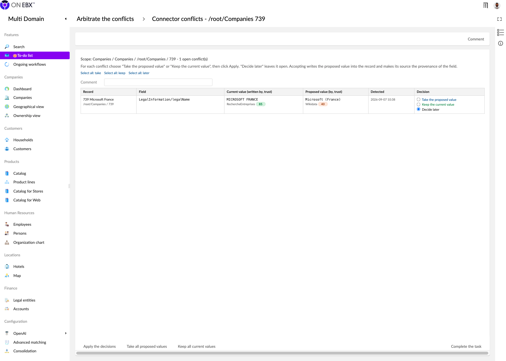

Through the REST API: `POST /ebx-connectors/rest/v1/conflicts/{id}/accept?comment=...` or `.../reject`.

## 10. Monitoring: the synchronisation log

Every call, from whatever entry point, writes one line in **Data connector › Runs and monitoring › Synchronisation log** (a feed run in batches writes one line per batch, plus an own line for each failing or conflicting record; the health metrics count the records of the batches, not the lines): timestamp, connector, operation, direction, record, status, message (number of changes, skipped fields, conflicts, errors), duration, user and origin (`REST admin`, `workflow`, `scheduler`, `trigger`, `webhook`). The same section provides **Connector operations**, **Execution runs**, **Outbound deliveries**, **Synchronization checkpoints**, and **Connector operational metrics**.

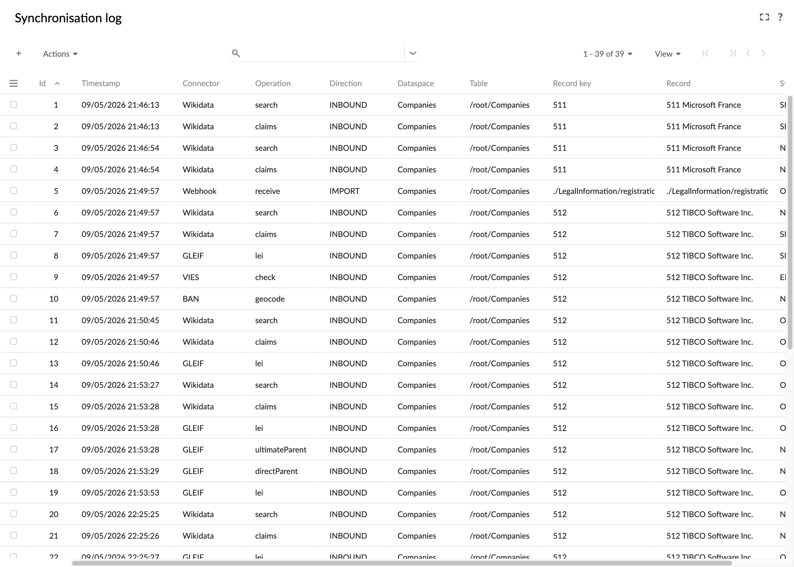

| Status | Meaning |
|---|---|
| `OK` | the record was updated |
| `NO_CHANGE` | the service answered, nothing to write (already set, or refused by the policy) |
| `NO_DATA` | the service does not know the entity (empty answer, 404) |
| `SKIPPED` | a required input was empty, or the record did not match |
| `ERROR` | the call failed: read the message (missing secret, quota, network) |
| `DRY_RUN` | simulation, nothing written |

## 11. Feeding a data catalog

The module is also the ingestion and publication layer of the ON EBX data catalog (`ebx-data-catalog`), but every piece below
works without it.

| Connector type | What it gives a catalog | Reference |
|---|---|---|
| `jdbc`, `postgresql`, `mysql`, `oracle-database`, `sql-server`, `azure-sql`, `h2` | `catalog`, `profile` and `sample` operations: tables and columns, daily column profiles, value samples | GUIDE § 17 |
| `snowflake`, `databricks` | the same, plus `usage` (queries per table over 30 days) and the platform's own column `lineage` | GUIDE § 17 |
| `powerbi` | reports, dashboards, semantic models, DAX measures and Power Query lineage, refresh history | GUIDE § 3.5 |
| `collibra` | business glossary in; assets, columns and lineage relations out | GUIDE § 3.6 |
| `ebx` | this or another EBX instance: tables from the data models, row counts, samples, foreign keys as lineage | GUIDE § 3.8 |
| `openlineage` | declared once, it describes every outbound run of every mapping to the catalog, Marquez or DataHub | GUIDE § 3.7 |

**A mapping that publishes EBX data updates the catalog by itself.** Declare one connector of type `openlineage` whose base URL is
the catalog's `/ebx-data-catalog/rest/v1/openlineage`. From then on, every run of an outbound mapping (from the user service, the
REST API, a workflow or a scheduled task) sends one event per mapping: the EBX table as input, the target object as output, one
column link per rule, and the counts of the run. The catalog records the job and the run, creates the target asset when it does
not know it yet, and draws the column lineage; the marketplace then shows the EBX table's new downstream consumer. Simulations and
empty runs send nothing, and a refused event never fails the run.

## 12. Quick reference

**Order of a typical enrichment** of a company: search by SIREN or name (*Recherche d'entreprises*, Sirene, Wikidata) to obtain the identifiers → the record by LEI (GLEIF) → complements (VIES VAT check, BAN or Melissa address, OpenSanctions screening) → parent relationships (GLEIF ultimate and direct parents).

**REST endpoints** (`/ebx-connectors/rest/v1`): `GET /connectors`, `GET /mappings?table=`, `POST /sync/{mapping}?key=|predicate=`, `POST /enrich?dataset&table&key|predicate&mappings|connectors`, `POST /webhook/{feed}`, `POST /connectors/openapi?id&url|body`, `GET /conflicts?status&dataspace&dataset&table&key`, `POST /conflicts/{id}/accept|reject?comment=`. Add `&dryRun=true` to simulate.

**Workflow**: script task bean `ConnectorScriptTaskBean`; user task service `ebx-connectors@ConflictManager` (input `service` = that key, `branch`, optional `dataset`, `table`, `recordKey`; outputs `resolvedCount`, `remainingCount`).

**Where to look when something is wrong**: the *Synchronisation log* message first; then the connector (secret `TO_BE_SET`, wrong URL, inactive); then the mapping inputs (an empty required input gives `SKIPPED`); then *Test on the sample* in the designer, which shows the exact answer of the service.
